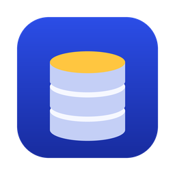
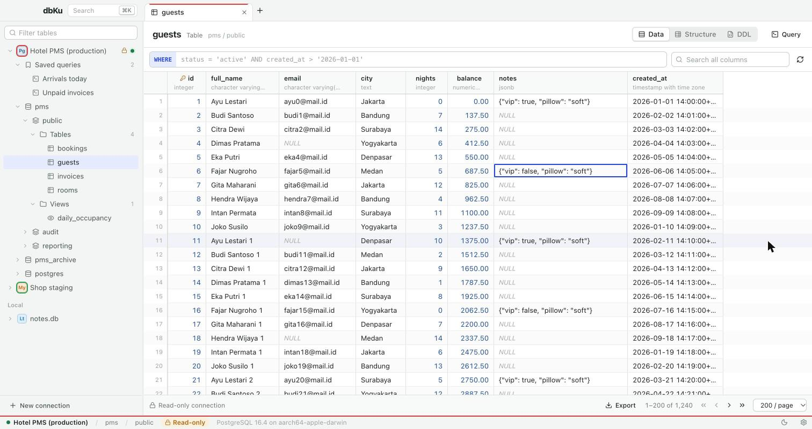
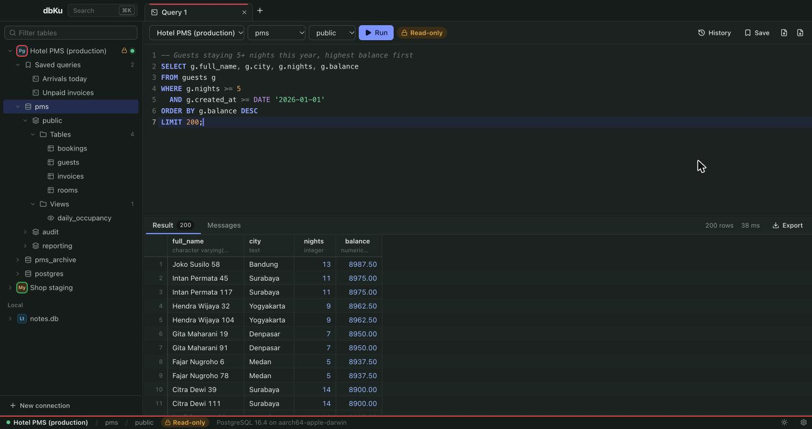
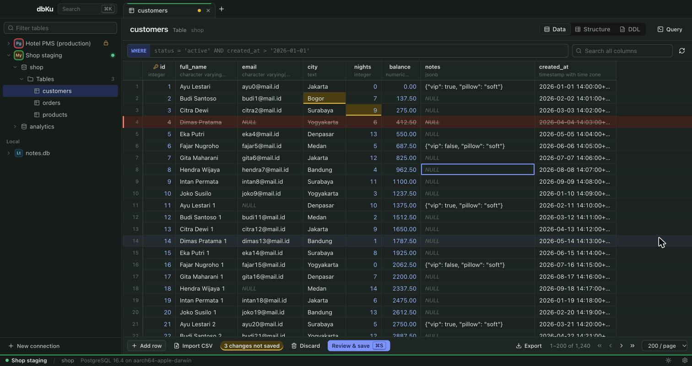
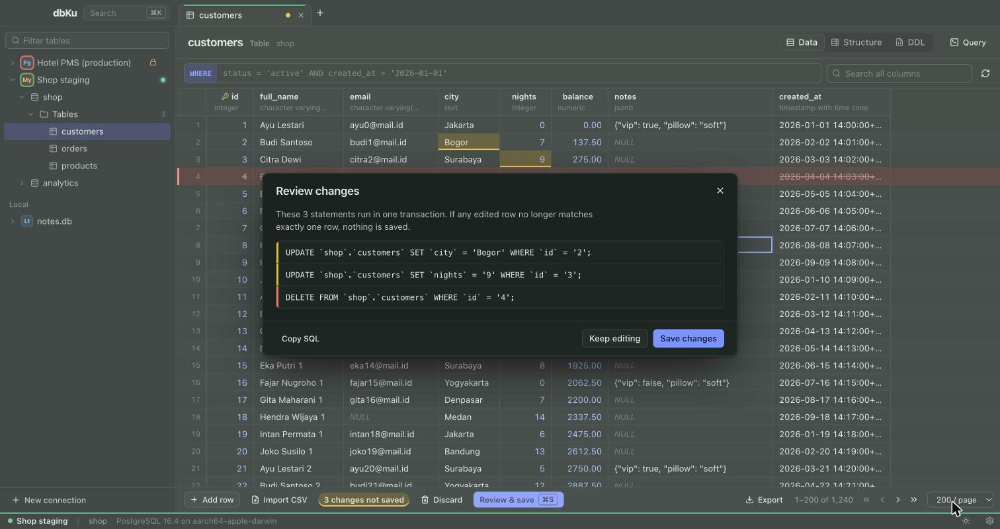
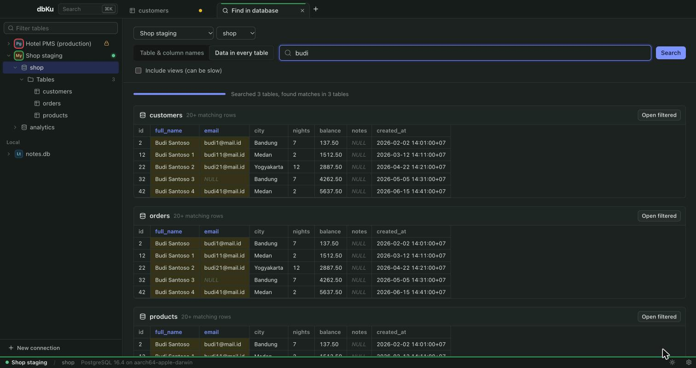
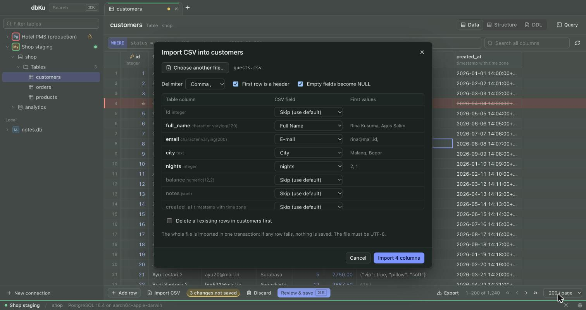
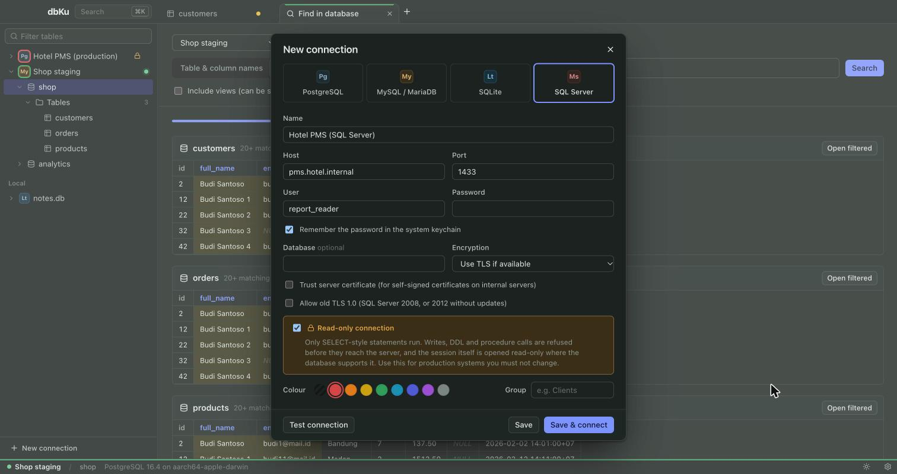

<p align="center">
  
</p>

<h1 align="center">dbKu</h1>

<p align="center">
  A small, fast, open-source database client for <b>PostgreSQL</b>, <b>MySQL / MariaDB</b>,
  <b>SQLite</b> and <b>SQL Server</b>.<br>
  Browse tables, edit rows, run SQL, search a whole database, import and export, all in an
  11&nbsp;MB desktop app.
</p>

<p align="center">
  <a href="https://github.com/mhrdwan/dbku/releases"></a>
  
  
  <a href="LICENSE"></a>
</p>

<p align="center">
  <a href="#download">Download</a> ·
  <a href="#features">Features</a> ·
  <a href="#build-from-source">Build</a> ·
  <a href="#bahasa-indonesia">Bahasa Indonesia</a>
</p>



## Why dbKu

- **Light.** About 11 MB to download. Idle, it uses about 83 MB of memory (the app plus its
  system web view) and no CPU (measured on macOS, Apple silicon). Big result sets are cut at a
  row limit you choose, and the grid only draws the rows on screen.
- **Safe on production.** Mark a connection read-only and dbKu refuses every write before it
  leaves your machine. Where the database supports it, the session is also opened read-only on
  the server. Give the connection a colour (red for production), and the active tab and status
  bar always show which server you're on.
- **Honest about edits.** Grid changes are shown as SQL before they run. They run in one
  transaction, and every UPDATE or DELETE must hit exactly one row, or nothing is saved.
- **One app for four databases**, including old SQL Server installations that newer tools
  can no longer reach.

## Screenshots

<table>
  <tr>
    <td width="50%"><br><sub><b>SQL editor.</b> Dialect-aware highlighting, table and column autocomplete, several result sets per run.</sub></td>
    <td width="50%"><br><sub><b>Grid editing.</b> Changed cells are highlighted, deleted rows struck through, and the tab shows unsaved work.</sub></td>
  </tr>
  <tr>
    <td><br><sub><b>Review before saving.</b> The exact statements, run in one transaction.</sub></td>
    <td><br><sub><b>Find in database.</b> Search table and column names, or the data in every table.</sub></td>
  </tr>
  <tr>
    <td><br><sub><b>CSV import.</b> Columns are matched by header name; the whole file is imported in one transaction.</sub></td>
    <td><br><sub><b>Connections.</b> Read-only mode, colours, groups, and passwords kept in the system keychain.</sub></td>
  </tr>
</table>

## Features

**Browse**
- Several connections open at once, with a schema tree (connections, databases, schemas,
  tables and views) that loads lazily and filters as you type.
- Table browser with server-side paging, multi-column sorting (shift-click), a free `WHERE`
  filter and a "search all columns" box. Right-click a cell to filter by its value.
- Jump to a column by name (`⌘J`) in wide tables and query results.
- Structure (columns, keys, indexes) and DDL view for every table and view.
- Command palette (`⌘K` / `Ctrl+K`) to jump to any table in any open connection.

**Edit**
- Edit cells, add and delete rows, set NULL, and open long text or JSON in a value viewer.
- Review the generated SQL, then save it in one transaction.
- Grid editing works on tables with a primary key.

**Query**
- SQL editor with highlighting for each dialect, autocomplete, find and replace, and history.
- `⌘↵` runs the selection, or the whole script. Each script can return several result sets.
- Every query tab has its own connection, so `BEGIN`, `SET` and temp tables stay with that tab.
  Closing the tab rolls back anything not committed.
- Stop a long query (PostgreSQL, MySQL). Results are cut at a row limit, so a careless
  `SELECT *` on a huge table won't freeze the app.
- Saved queries (`⌘S`) live under their connection in the sidebar. `.sql` files can be opened
  and saved too.

**Search, import and export**
- Find in database: search table and column names, or the data in every table.
- Export a schema, database or table as a SQL script (structure and data). Rows stream
  straight to the file, so big tables don't load into memory.
- Import CSV into a table, with columns matched by header name.
- Run a `.sql` file of any size statement by statement, with progress, Cancel, and a report of
  the statement that failed.
- Export results as CSV, TSV, JSON or Markdown, or copy them into a spreadsheet.

**Everything else**
- Passwords are kept in the system keychain (macOS Keychain, Windows Credential Manager,
  Secret Service on Linux) and never written to a file.
- Light and dark themes.

## Download

Get the latest build from the **[Releases page](https://github.com/mhrdwan/dbku/releases)**.

| System | File | Notes |
| --- | --- | --- |
| **macOS** (Apple silicon and Intel) | `dbKu_x.y.z_universal.dmg` | Open it and drag dbKu to Applications. The first time, right-click dbKu → **Open** (the app isn't notarised by Apple yet). |
| **Windows** 10 / 11 | `dbKu_x.y.z_x64-setup.exe` or `.msi` | If SmartScreen says "Windows protected your PC", click **More info → Run anyway** (the app isn't code-signed yet). |
| **Ubuntu / Debian** 22.04+ | `dbKu_x.y.z_amd64.deb` | `sudo apt install ./dbKu_x.y.z_amd64.deb` |
| **Other Linux** | `dbKu_x.y.z_amd64.AppImage` | `chmod +x` it, then run it. Nothing to install. |

The first time dbKu reads a saved password, macOS asks for permission to use the keychain.
Enter your **Mac login password** and choose **Always Allow**.

## Connecting

- **PostgreSQL / MySQL / MariaDB / SQL Server.** Host, port, user, password and optionally
  a database. Choose *Require TLS* for servers on the internet.
- **SQLite.** Pick a file, or create a new one.
- **Supabase.** Use PostgreSQL with the *Session pooler* details from the dashboard (host
  `aws-0-<region>.pooler.supabase.com`, port `5432`, user `postgres.<project-ref>`) and
  *Require TLS*. The direct host is IPv6-only, and the transaction pooler (port 6543) doesn't
  keep a session per tab.
- **Old SQL Server** (2008, or 2012 without updates) only speaks TLS 1.0 and uses a 1024-bit
  self-signed certificate. Tick **Allow old TLS 1.0** and **Trust server certificate**. dbKu
  bundles OpenSSL for SQL Server, so this works the same on every system.

## Read-only mode

A read-only connection has two layers of protection.

1. **Statement guard** ([`src-tauri/src/sql/guard.rs`](src-tauri/src/sql/guard.rs)).
   - Every statement must start with a reading keyword (`SELECT`, `WITH`, `SHOW`, `EXPLAIN`, …).
   - Writing keywords are refused anywhere in a statement: `INSERT`, `UPDATE`, `DELETE`,
     `MERGE`, `DROP`, `CALL`, `EXEC`, `INTO`, `COPY` and others.
   - Functions with side effects are refused too, such as `nextval`, `set_config`,
     `query_to_xml`, `OPENROWSET` and `load_extension`.
   - The guard reads real tokens with each server's own comment and string rules. A `delete`
     inside a string doesn't trigger it. MySQL's `/*! … */` executable comments, and T-SQL
     statements that need no `;` (`KILL`, `BACKUP`, `DBCC`, `SET`, …), can't sneak past it.
   - Table filters typed in the browser and SQL files go through the same guard.
2. **The database itself.**
   - PostgreSQL sessions start with `default_transaction_read_only = on`.
   - MySQL uses `SET SESSION TRANSACTION READ ONLY`.
   - SQLite files are opened read-only.
   - On SQL Server every batch runs inside a transaction that is always rolled back.

The guard is strict on purpose. It may refuse a harmless statement such as
`SELECT … FOR UPDATE`, but it must never let a write through. If you find a statement that
writes and still passes, please [open an issue](https://github.com/mhrdwan/dbku/issues).

## Keyboard shortcuts

On Windows and Linux, use `Ctrl` where macOS uses `⌘`.

| Keys | Action |
| --- | --- |
| `⌘K` | Jump to a table or command |
| `⌘T` | New query tab |
| `⌘↵` | Run the selection, or the whole script |
| `⌘S` | Save the query (query tab) / review and save edits (table tab) |
| `⌘F` | Search the rows of the open table |
| `⌘J` | Jump to a column by name (table tab) |
| `⇧⌘F` | Find in database |
| `⌘R` | Refresh table data |
| `⌘W` | Close tab |
| `⇧⌘[` `⇧⌘]` or `Ctrl+Tab` | Previous / next tab |
| `⇧⌘E` | Focus the tree filter |
| `Enter` / `F2` | Edit the active cell |
| `⇧Space` | View a cell's full value |
| `⌘⌫` | Mark the selected rows for deletion |

## Import and export notes

- Files are chosen in native dialogs on the Rust side. The UI only receives a token for the
  chosen file, so it can't read or write anything else.
- SQL dumps restore with *Run SQL file…* or any SQL client, into the same or another
  database. They include tables, keys, indexes, foreign keys, views (in dependency order),
  PostgreSQL enums and schema creation.
- Dumps aren't a replacement for `pg_dump`, `mysqldump` or SQL Server backups. Domains,
  functions, procedures, triggers (except SQLite's), permissions and partitioning aren't
  included, and tables are read one after another rather than from one snapshot.
- Read-only connections can export but not import.
- CSV files must be UTF-8. Excel's "CSV UTF-8" works.

## Known limitations

- No SSH tunnels yet. Use `ssh -L` for now.
- SQL Server: SQL logins only (no Windows or Kerberos authentication). Named instances need
  an explicit port. Query tabs share one editor connection.
- On Windows, SQL Server certificate checks don't use the Windows certificate store. Use
  *Trust server certificate* for internal servers.
- Stopping a running query works on PostgreSQL and MySQL only.
- MySQL stored-procedure scripts need `DELIMITER` lines, as in the `mysql` command-line client.

## Build from source

Requirements:

- Rust 1.85 or newer (`rustup`), Node.js 20+ and [pnpm](https://pnpm.io).
- The [Tauri prerequisites](https://v2.tauri.app/start/prerequisites/) for your system.
- Perl (and `make` on macOS and Linux), to build the OpenSSL that SQL Server connections use.
  - On Windows, install [Strawberry Perl](https://strawberryperl.com).
  - On Linux, also install `libdbus-1-dev` and `pkg-config`.

```bash
git clone https://github.com/mhrdwan/dbku.git
cd dbku
pnpm install
pnpm tauri dev      # run in development
pnpm tauri build    # build an installer for your system
```

To work on the UI without Rust, run `pnpm dev` and open http://localhost:1420 in a browser. A
demo backend with sample data ([`src/dev/mockBackend.ts`](src/dev/mockBackend.ts)) answers
the calls. It is only loaded in development and never ships.

## Tests

```bash
pnpm check && pnpm test          # Svelte/TypeScript types and UI logic
cd src-tauri
cargo clippy --all-targets -- -D warnings
cargo test                       # SQL lexer, read-only guard, builders, IPC contract, SQLite end-to-end
```

The driver and transfer suites run the same scenarios against real servers when you point
them at disposable databases. They create and drop tables named `dbku_*`.

```bash
DBKU_TEST_POSTGRES="127.0.0.1:5432:user:password:dbname" \
DBKU_TEST_MYSQL="127.0.0.1:3306:root:password:dbname" \
DBKU_TEST_MSSQL="127.0.0.1:1433:sa:password:dbname" \
cargo test
```

CI runs all of this against PostgreSQL 16, MySQL 8.4 and SQL Server 2022 containers.

## Releasing

Push a version tag and GitHub Actions builds installers for macOS, Windows and Linux into a
draft release:

```bash
git tag v0.1.0
git push origin v0.1.0
```

Check the draft on the Releases page, then publish it.

## Architecture

```
src/                       Svelte 5 UI
  lib/api.ts               typed IPC calls (mirror src-tauri/src/commands.rs)
  lib/state/               connections, schema cache, tabs, saved queries, settings
  lib/util/                pure logic with unit tests (grid edits, export, quoting, mapping)
  components/              grid, SQL editor, table/query/search tabs, sidebar, dialogs
src-tauri/src/             Rust backend
  commands.rs              IPC commands; transfer_commands.rs for files and saved queries
  sql/                     lexer and statement splitter, read-only guard, SQL builders
  db/                      one backend per engine: sqlx (PostgreSQL, MySQL, SQLite), tiberius (SQL Server)
  transfer/                SQL dump, CSV import, running SQL files
  store.rs, saved.rs       connection profiles and saved queries (JSON) + system keychain
src-tauri/vendor/tiberius  SQL Server driver with a small TLS patch (see DBKU_PATCH.md)
```

Values cross the IPC bridge as text (`string | null`), read through each database's text
protocol, so every type is shown the way the database itself prints it.

## Contributing

Issues and pull requests are welcome. Please read [CONTRIBUTING.md](CONTRIBUTING.md) first.
Changes to the read-only guard need a test for every statement they allow or block.

## License

[MIT](LICENSE). The bundled tiberius driver is MIT or Apache-2.0.

---

## Bahasa Indonesia

**dbKu** adalah database client open-source yang ringan, mirip Navicat, untuk **PostgreSQL**,
**MySQL / MariaDB**, **SQLite**, dan **SQL Server**. Ukurannya sekitar 11 MB, dan saat diam
memakai sekitar 83 MB RAM tanpa beban CPU.

**Fitur utama**
- Banyak koneksi sekaligus. Tiap koneksi bisa diberi warna, misalnya merah untuk produksi.
- **Mode baca-saja** untuk server produksi. Perintah tulis ditolak sebelum sampai ke server, dan
  sesinya juga dibuka read-only di sisi database.
- Penjelajah tabel dengan paging, sort, filter `WHERE`, dan pencarian di semua kolom.
- Edit data langsung di grid. SQL-nya ditinjau dulu, lalu dijalankan dalam satu transaksi.
- Editor SQL dengan autocomplete, riwayat, saved queries, dan tombol Stop.
- **Find in database**: cari nama tabel/kolom, atau cari isi data di semua tabel.
- Export database ke file `.sql`, import CSV, dan jalankan file `.sql` berukuran besar.
- Password disimpan di Keychain sistem operasi.

**Download.** Ambil installer di halaman [Releases](https://github.com/mhrdwan/dbku/releases):
`.dmg` untuk Mac, `.exe` / `.msi` untuk Windows, `.deb` / `.AppImage` untuk Linux.
- **Mac:** saat pertama dibuka, klik kanan → **Open**.
- **Windows:** kalau muncul "Windows protected your PC", klik **More info → Run anyway**.
- **Keychain Mac:** saat diminta, isi dengan password login Mac lalu pilih **Always Allow**.

**SQL Server lama** (2008, atau 2012 tanpa update): centang **Allow old TLS 1.0** dan **Trust
server certificate** di pengaturan koneksi.

**Build sendiri:** `pnpm install`, lalu `pnpm tauri dev` untuk mencoba atau `pnpm tauri build`
untuk membuat installer. Kebutuhan lengkapnya ada di bagian [Build from source](#build-from-source).
